  

# Hi, I'm Jakub 👋

Final year BEng student of Artificial Intelligence at Poznań University of Technology. Data science with a focus on machine and deep learning for biological and medical applications: medical imaging, vision systems and biomedical data. Currently exploring LLM agents over biomedical knowledge graphs, RAG pipelines and local LLM applications.

## Projects

### ⚛️ [Ligand Identification with Equivariant Neural Networks](https://github.com/agatabielska/ligand-identification)
Equivariant neural networks for ligand identification in X-ray crystallography and cryoEM density maps, providing rotational equivariance for arbitrary ligand orientations. Used E3NN framework and Clifford Steerable CNN.

### 🛰️ [EarthSignal — NASA Space Apps Challenge 2026](https://github.com/agatabielska/nasa-spaceapps-challenge)
Team entry turning NISAR radar data into an interactive globe of floods, wildfires, eruptions and ground subsidence, using SAR change detection and an unsupervised deep-learning change detector (UCDFormer). [Live demo](https://earthsignal-blue-trust.onrender.com/)

### 🧠 [RAG Learning Assistant](https://github.com/jakubradziejewski/rag-learning-assistant)
RAG-based study platform with SM-2/FSRS spaced repetition. Upload lecture materials, get context-aware answers with sources, and have an agent schedule revision sessions around your knowledge gaps. Fully local inference via Docker Model Runner.

### 🏭 [StackGear AI](https://github.com/jakubradziejewski/stackgear-ai)
Full-stack hardware inventory management system with AI-powered semantic search and automated inventory auditing via Google Gemini. Features real-time Socket.IO updates and role-based access control. FastAPI + Vue 3, deployed on Render/Vercel/Neon.

### 🏗️ [Crack Detection](https://github.com/jakubradziejewski/crack-detection)
Weakly-supervised semantic segmentation achieving pixel-level precision using only image-level labels — dilated ResNet-34 + Grad-CAM++ for pseudo-label generation, U-Net for refinement.

### 💊 [LLMs in Drug Repurposing](https://github.com/jakubradziejewski/reproducible-agents-biomedical-kg) *(in progress)*
Text-to-Cypher LLM agents over the Hetionet biomedical knowledge graph, measuring both the correctness and the run-to-run determinism of their answers.

### 🔬 [LiveCell Instance Segmentation](https://github.com/jakubradziejewski/livecell-instance-segmentation)
Custom Mask R-CNN with CBAM attention for live cell microscopy segmentation, with full MLOps setup — Docker, DVC data versioning, and Gradio inference interface.

### 🎲 [Gameplay Event Detection](https://github.com/jakubradziejewski/gameplay_event_detection)
Real-time multi-object detection and event recognition pipeline for board game footage using watershed segmentation, KCF tracking, and Hough transforms.

### 🚗 [Detecting Moving Objects in DAS Recordings](https://github.com/jakubradziejewski/detecting-moving-objects-in-das-recordings)
Vehicle trajectory extraction from fiber-optic DAS sensor data using adaptive thresholding, morphological operations, and velocity-based Hough Transform filtering.

### 📚 [Wikipedia Recommending System](https://github.com/jakubradziejewski/wikipedia_recommending_system)
Content-based article recommender built with Scrapy, NLTK, and TF-IDF cosine similarity, with explainability analysis across multiple recommendation strategies.

### 🏆 [Tournament System](https://github.com/jakubradziejewski/tournament-system)
Full-stack real-time tournament platform with Next.js, Socket.IO, PostgreSQL, JWT auth, and race condition prevention via database transactions.

---

               

---

**[LinkedIn](https://www.linkedin.com/in/jakub-radziejewski/)**
